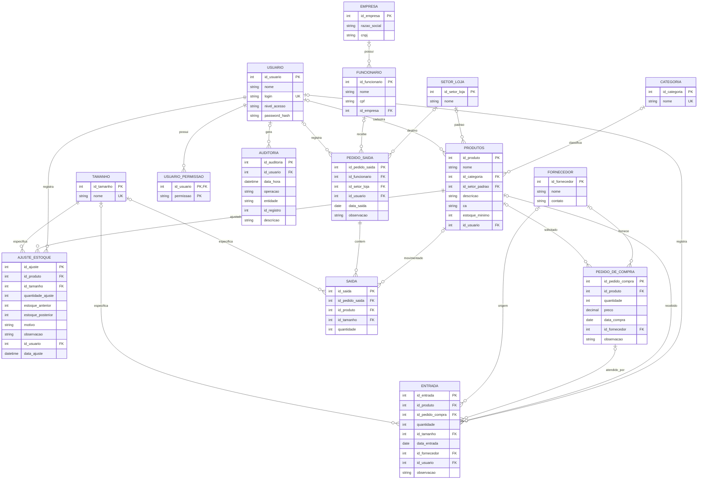

# Epi Control


Aplicativo desktop independente para controle de EPI e fardamento em Windows, desenvolvido a partir da identificação de necessidades operacionais e da aplicação de tecnologia para otimização de processos de gestão.

O projeto utiliza SQLite como banco de dados local, sem necessidade de configuração de banco remoto. Seu desenvolvimento contou com o apoio de Inteligência Artificial (ChatGPT) na geração e evolução do código, sob condução do idealizador, responsável pela definição dos requisitos, estruturação das informações, orientação das funcionalidades e validação da aplicação.

## Processo de desenvolvimento e utilização de IA

O EPI Control foi concebido e conduzido a partir da identificação de necessidades reais relacionadas à gestão e ao controle de Equipamentos de Proteção Individual.

O desenvolvimento contou com o uso de Inteligência Artificial (ChatGPT) como ferramenta de apoio à programação, geração e evolução do código-fonte.

A condução do projeto envolveu:

- Definição dos objetivos e requisitos funcionais da aplicação.
- Organização das informações, processos e regras de negócio.
- Criação manual da estrutura inicial do banco de dados utilizando MySQL, incluindo tabelas e relacionamentos.
- Utilização de IA como apoio à conversão e adaptação da estrutura do banco de dados para SQLite.
- Orientação do desenvolvimento por meio de instruções detalhadas sobre funcionalidades e comportamentos esperados.
- Realização de testes funcionais, identificação de inconsistências e solicitação de ajustes.
- Validação das funcionalidades e evolução contínua da aplicação.

A utilização de IA permitiu acelerar o processo de desenvolvimento, mantendo a condução das decisões funcionais, a organização das informações e a validação dos resultados sob responsabilidade do idealizador do projeto.

## Funcionalidades

- Cadastro de empresas, funcionários, produtos, tamanhos, fornecedores e setores/lojas.
- Pedidos de compra e entradas de estoque vinculadas aos pedidos.
- Saídas de estoque vinculadas a funcionários, com validação de saldo.
- Controle de acesso por usuário e permissões, com configuração do primeiro administrador no primeiro acesso.
- Relatórios e histórico de operações.
- Geração de termos de responsabilidade em PDF.
- Importação de cadastros por planilhas Excel ou CSV e geração de modelos de importação.

## Modelo de dados

O esquema abaixo representa as 15 tabelas definidas pelos modelos SQLAlchemy do aplicativo. Ele mostra a estrutura, sem registros reais ou dados pessoais. O diagrama antigo de referência não foi reutilizado porque continha campos que não existem no esquema atual.



`importacao_historica` não aparece porque não faz parte dos modelos ORM usados para criar o banco SQLite novo. O script histórico que contém essa tabela é separado do esquema principal.

## Requisitos para executar pelo código-fonte

- Windows 64 bits.
- Python 3.10 ou superior. O código usa anotações de tipo introduzidas no Python 3.10; a compilação atual foi feita com Python 3.15.2.
- Dependências listadas em `app/requirements.txt`.

Instale as dependências e inicie a interface a partir da pasta raiz:

```powershell
python -m pip install -r app\requirements.txt
$env:PYTHONPATH = (Resolve-Path .\app).Path
python .\app\app_gui.py
```

Sem `EPICONTROL_TEST_DB_PATH`, o aplicativo usa o banco do usuário em:

```text
%LOCALAPPDATA%\EPIControl\data\epicontrol.db
```

O banco é criado automaticamente no primeiro início. Nesse primeiro acesso, cadastre um administrador com senha própria. A senha deve ter pelo menos 8 caracteres e conter letras e números.

## Dados fictícios de demonstração

O script `test_data/seed_fake_data.py` cria empresas, funcionários, fornecedores, produtos, pedidos, estoque e uma saída inteiramente fictícios. Os CPFs e CAs são dados de teste, não identificadores ou certificados oficiais.

```powershell
python .\test_data\seed_fake_data.py
$env:EPICONTROL_TEST_DB_PATH = (Resolve-Path .\test_data\epicontrol_teste.db).Path
$env:PYTHONPATH = (Resolve-Path .\app).Path
python .\app\app_gui.py
```

Login de demonstração: `admin_teste` / `Teste123`. Esse acesso é exclusivo do banco fictício. O executável empacotado ignora `EPICONTROL_TEST_DB_PATH` e usa o banco normal do usuário.

O banco de demonstração e os PDFs gerados são dados locais e estão excluídos do Git. O script e o README em `test_data/` podem ser versionados para recriar a demonstração.

## Build do executável e instalador

Versões usadas na build atual: Python 3.15.2, PyInstaller 6.22.3 e Inno Setup 6.7.3. O Inno Setup é uma ferramenta separada e precisa estar instalado no computador de build.

```powershell
python -m pip install -r requirements-build.txt
.\PREPARAR_INSTALADOR.bat
```

O script gera `dist_instalacao/EpiControl.exe` e `dist_instalador/EpiControlSetup-1.0.1.exe`. O instalador instala por usuário e não inclui bancos, certificados ou configurações locais. A desinstalação preserva o banco do usuário.

Para distribuir o instalador, use um release do GitHub em vez de adicioná-lo ao histórico do código-fonte.

## Configurações locais e publicação

`app/configuracoes_sistema.json` guarda configurações locais dos modelos e do logotipo dos termos. Esse arquivo não deve ser publicado; o aplicativo usa valores padrão quando ele não existe. Bancos SQLite, credenciais de demonstração, PDFs gerados, certificados e arquivos de build também estão excluídos pelo `.gitignore`.

O projeto é publicado sem arquivo de licença, por opção do autor. Os dados de contato mostrados na tela Sobre e nos metadados do instalador são públicos neste repositório.
